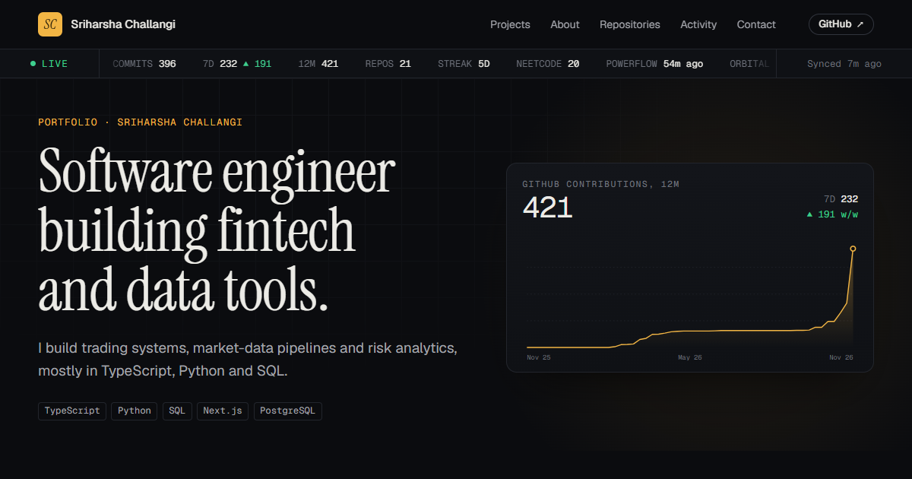

# devligan.github.io

My portfolio. It rebuilds itself from my GitHub every hour, so new repos, commits and stats show up without me touching it.

**Live:** https://devligan.github.io



## How it stays current

```
GitHub API ──► scripts/fetch-github.mjs ──► src/data/github.json ──► astro build ──► GitHub Pages
                 (hourly, on push, or on demand via the Actions tab)
```

- **Ticker and hero chart**: commits, contributions (cumulative over 12 months, plus the week-over-week change), streak, and when each project was last pushed.
- **Repositories**: every public, non-fork repo, newest first, filterable by language.
- **Activity**: the 12-month contribution calendar and real commit messages from the most active repos.
- **Project images**: the first screenshot in each featured repo's README, downloaded at build time.

If GitHub is unreachable, the last snapshot is kept and the site still builds.

## Curating it from GitHub

| Want to… | Do this |
| --- | --- |
| Feature a repo in Projects | Add the topic `portfolio` to the repo |
| Hide a repo | Add the topic `portfolio-hide` |
| Change a blurb | Edit the repo's description |
| Write a proper case study | Add an entry to `projects` in `portfolio.config.mjs` |

Everything hand-written (headline, bio, skills, case studies, contact links) lives in [`portfolio.config.mjs`](portfolio.config.mjs).

## Running it

```bash
npm install
npm run sync    # pull fresh data (uses `gh auth token` or $GITHUB_TOKEN)
npm run dev     # http://localhost:4321
npm run build
```

Built with Astro and no client framework. One small script handles relative times, the repository filter and scroll effects. The page works without JavaScript and respects `prefers-reduced-motion`.
